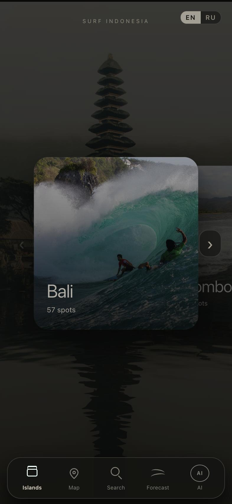
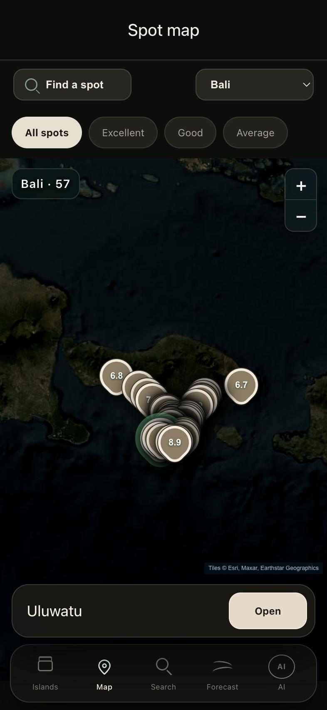
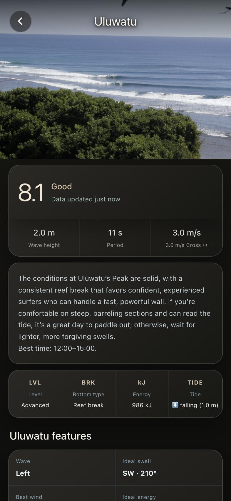
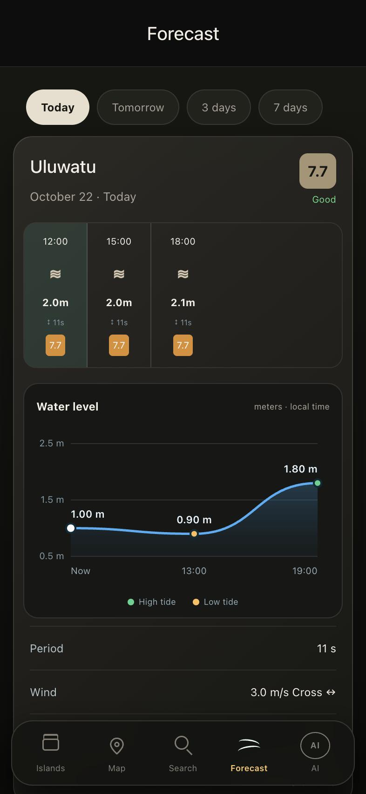

# Surf Indonesia

A Telegram bot with a Mini App for surfers. The source code is private; this page shows what it does and how it is built.

**[Open @SurfIndoBot in Telegram](https://t.me/SurfIndoBot)** · [Mini App web preview](https://surf-indonesia.web.app) (personal profile and AI assistant work inside Telegram)

## What it does

- Surf spots across Bali, Lombok, Sumbawa, Sumba, Java and Mentawai, each with a conditions score
- Wave height, period, swell direction, wind and tide
- Best time to surf and a plain-language analysis of the conditions
- A personal surfer profile (level, board, wave size, break type) that tunes the recommendations
- Favourite spots and a spot map
- An AI assistant that answers surf questions using the live conditions
- English and Russian interface: the language follows the Telegram language and can be switched in the app

## How it is built

| Layer | Technology |
|---|---|
| Bot | Python, pyTelegramBotAPI in webhook mode |
| Mini App | React and TypeScript, static site on Firebase Hosting |
| API | Python on Google Cloud Run, scales to zero when idle |
| Data | PostgreSQL on Supabase |
| AI | Groq API |
| Security | Telegram Mini App init-data verification (HMAC-SHA256), secrets in Google Secret Manager |

## Screenshots

The interface is available in English and Russian.

| Islands | Map | Spot | Forecast |
|---|---|---|---|
|  |  |  |  |

## Contact

Igor Mosur · https://appflow-dev.web.app
